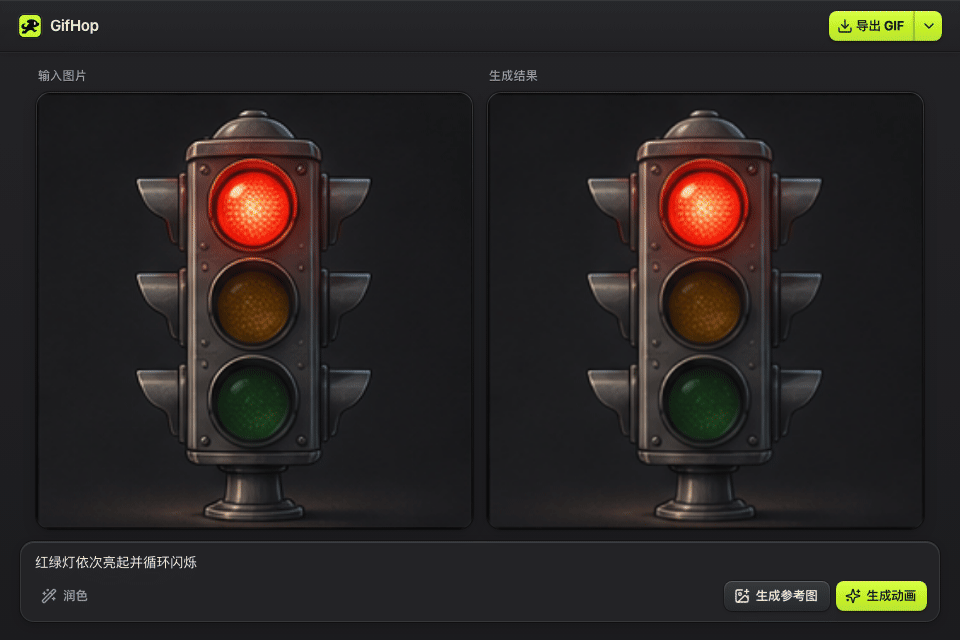

<p align="center">
  
</p>

<h1 align="center">GifHop</h1>

<p align="center">
  免费开源的桌面动图工作室，支持 macOS、Windows 和 Linux。<br />
  参考图处理、24 帧动画切分预览与 GIF / 动画 WebP / 视频导出均在本机完成，AI 能力直连本机 <strong>Codex CLI</strong>。
</p>

<p align="center">
  <a href="https://github.com/Bavoch/GifHop/releases"><strong>下载安装包</strong></a> ·
  <a href="docs/desktop.md">运行与安全说明</a> ·
  <a href="docs/releasing.md">发布流程</a> ·
  <a href="LICENSE">MIT 开源协议</a>
</p>

<p align="center">
  
</p>

## 开始使用

1. 安装对应平台的 GifHop 安装包。
2. 安装 [Codex CLI](https://developers.openai.com/codex/cli)，版本至少 `0.164.0`，并在终端完成 ChatGPT 登录：

   ```sh
   npm install -g @openai/codex
   codex login
   ```

3. 打开 GifHop 桌面窗口，标题栏自动显示 Codex 连接状态。PandaGO 或浏览器内的网页预览不连接本机 Codex。完成安装或登录后，回到应用会自动重新检测，无需手动连接。
4. 填写创意，或上传 PNG / JPEG / WebP 参考图。上传图片不会发起 AI 请求或改写输入框；可以留空由模型根据原图自由构思动画，也可以手动描述动作，或在已有文字上点击「润色」。每次生成一个动画，可随时取消。
5. 左侧查看参考图，右侧播放生成结果，点击标题栏右侧「导出 GIF」导出动画，右侧箭头可切换 WebP 或视频格式。结果画面右下角可直接删除当前结果，删除后预览清空且不显示成功提示；重新生成会替换当前结果。

GifHop 本身免费。AI 请求由用户安装的 Codex CLI 发往其 ChatGPT 服务，仍需联网，且受账户资格、用量和生图能力限制。GifHop 不提供无限免费模型额度，也不在设备上运行模型推理。API Key 登录不属于本版支持路径。

## 下载与兼容性

- macOS：Apple Silicon (`arm64`) 与 Intel (`x64`)，macOS 13 或更新版本。
- Windows：64 位 Windows 10 / 11。
- Linux：x64 AppImage 和 Debian 包；已在 Ubuntu 24.04 CI 构建与隐藏窗口测试。
- Ubuntu 24.04 等限制用户命名空间的系统优先安装 `.deb`，由安装器配置沙箱及 AppArmor；AppImage 需要系统允许用户命名空间，不自动关闭沙箱。
- 视频导出优先 MP4，不支持该编码时使用 WebM。

`1.0.0-rc.5` 是候选发布：macOS 使用 ad-hoc 签名，尚无 Developer ID 公证；Windows 尚无发行者签名。系统可能提示未知开发者。请从本仓库 Releases 获取包，并核对 `SHA256SUMS.txt`。这不是已完成签名、公证及所有实体设备验收的正式版本。

## 数据与隐私

- 只保存当前结果与参考图：编辑状态自动写入本机，关闭后重新打开会自动恢复；生成新结果或删除结果会替换这些本地文件，不保留历史版本。
- 当前素材位于应用数据目录的 `draft-assets/`（macOS 为 `~/Library/Application Support/fox24/draft-assets/`），恢复记录 `recovery.json` 只引用这些文件。无需手动打开或保存工程，备份应用数据目录即可保留当前编辑状态。
- GifHop 不读取、复制或上传 Codex 登录凭据。登录、刷新及账户使用由 CLI 负责。
- 每个 AI 任务使用独立临时目录；参考图仅随该次请求交给 Codex。正常结束、失败或取消均清理临时目录。
- 生图只读取本次 CLI 会话 ID 对应的 PNG / JPEG / WebP。Codex 自己的生成文件仍保留在其数据目录。
- 任务忽略个人 API 配置、插件和项目指令，禁用 shell 与多代理工具，使用只读沙箱。自动优先使用账号可用的 GPT-6 Luna，备用 GPT-5.6 Luna；不使用旧的手选模型或高价默认模型，不开启付费加速。标题栏仅展示连接状态，不提供下拉面板。
- 图像有大小与像素限制；UI 无外网请求，不加载远程字体，没有遥测和自动上传。

## 开发与验证

要求 Node.js 22.22+。依赖版本及 lockfile 固定。界面使用 HeroUI v3 免费开源组件及 Tailwind CSS v4，交互层复用 React Aria；主界面为左右正方形预览，底部集中输入与生成操作，不包含逐帧编辑；动画处理与导出在本地完成。第三方许可随应用附在 `THIRD_PARTY_NOTICES.txt`。

```sh
npm ci
node node_modules/electron/install.js  # 仅在包管理器禁用安装脚本时需要
npm run dev                           # UI 热更新；主进程和 preload 修改后自动重启桌面窗口
npm test                              # CLI 生命周期、安全边界与图像编码器
npm run build                         # 一轮实现完成后构建
npm run test:ui                        # Chromium 无头流程验证
GIFMAKER_TEST_URL=http://127.0.0.1:5173 npm run test:ui # 复用已有开发服务
npm run notices                        # 更新依赖后生成第三方许可
npm run test:desktop                   # Electron 隐藏窗口烟雾测试
npm run dist                          # 当前平台打包
```

自动测试全程无头或隐藏窗口，不打开前台浏览器。Linux 桌面烟雾测试需要 `xvfb-run -a npm run test:desktop`。本机真实 CLI 验证应单独运行，不在 CI 使用真实账户或消耗额度。

开发启动支持 `PORT` 环境变量和 `npm run dev -- --port 51269`，可使用 PandaGO 分配的随机端口，未指定时默认 5173；桌面窗口、热更新和来源校验使用同一个端口。开发模式监听 `desktop/` 下的代码及 `animation-prompt.mjs`、`animation-title.mjs`、`reference-crop.mjs`，保存后合并短时间内的修改并自动重启 Electron，Vite 服务保持运行。自动重启前即时保存当前工程，重启后直接恢复，无需点击「恢复工程」；保存失败时保留当前窗口。自动重启会取消尚未完成的 AI 任务。普通启动仍提供恢复确认。退出开发应用或按 Ctrl+C 会同时关闭开发服务。

## 开源协议

本项目基于 [MIT License](LICENSE) 免费开源。第三方依赖许可详见 [THIRD_PARTY_NOTICES.txt](public/THIRD_PARTY_NOTICES.txt)。
